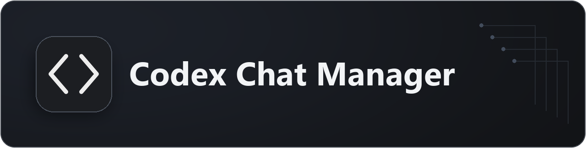

[English](#english) · [Русский](#русский)

## English

A native Rust app for browsing and managing local Codex chat history on Windows 10 and 11.

### Download and use

1. Download [CodexChatManager.exe](https://github.com/mdxxl/CodexChatManager/releases/latest/download/CodexChatManager.exe) and run it. The app uses the installed Codex CLI and normally finds it automatically. You can select it manually under **Connection**.
2. Search, select, and delete individual chats, or use **Delete all chats** to review the full list, including archived and auxiliary chats. Finish any running tasks and close Codex before deleting. Review the list and type `DELETE` to confirm permanent deletion.
3. Use **Remove stale links** if the Codex sidebar still points to deleted chats and shows `no rollout found`.

### Build

Use stable Rust for Windows x64 and Visual Studio Build Tools with **Desktop development with C++**. From the repository root, run:

```powershell
cargo build --release --locked
```

The standalone executable is at `target\release\CodexChatManager.exe`.

## Русский

Приложение на Rust для просмотра и управления локальной историей чатов Codex в Windows 10 и 11.

### Скачивание и запуск

1. Скачайте [CodexChatManager.exe](https://github.com/mdxxl/CodexChatManager/releases/latest/download/CodexChatManager.exe) и запустите его. Программа использует установленный Codex CLI и обычно находит его автоматически. Указать путь вручную можно в разделе **«Подключение»**.
2. Найдите и отметьте нужные чаты или нажмите **«Полная очистка»**, чтобы просмотреть весь список, включая архив и служебные чаты. Перед удалением завершите задачи и закройте Codex. Проверьте список и введите `УДАЛИТЬ` для подтверждения необратимого удаления.
3. Нажмите **«Убрать старые ссылки»**, если в боковой панели Codex остались записи с ошибкой `no rollout found`.

### Сборка

Понадобятся стабильный Rust для Windows x64 и Visual Studio Build Tools с компонентом **«Разработка классических приложений на C++»**. В корне репозитория выполните команду:

```powershell
cargo build --release --locked
```

Готовый файл находится по пути `target\release\CodexChatManager.exe`.
